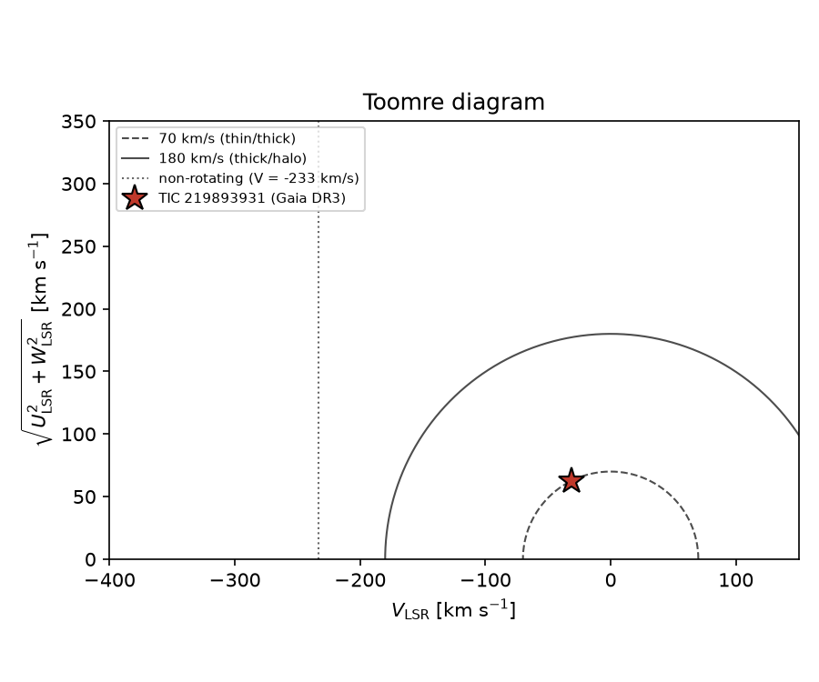

# low-metal-planet

Is TIC 219893931 really an extremely metal-poor planet host?

The NASA Exoplanet Archive lists **TIC 219893931 b** (TESS, P = 6.41 d,
R = 2.9 R⊕) with a host metallicity of **[Fe/H] = −2.83 ± 0.23**, from
Hotnisky et al. 2026 (ApJS 286, 42). That would make it one of the most
metal-poor planet hosts known. This repo runs three independent checks
on that number using public data for the host, Gaia DR3 1651056179580039424.

**Verdict: the −2.83 value is almost certainly wrong.** All three checks point
to an ordinary, single, near-solar-metallicity F/G dwarf
([M/H] ≈ −0.4 to +0.3) with disk kinematics.



## 1. Kinematics (Gaia DR3 astrometry + RVS radial velocity)

| quantity | value |
|---|---|
| parallax | 2.472 ± 0.011 mas → d = 404.6 ± 1.8 pc |
| proper motion | (16.33, 2.54) mas/yr → v_tan = 31.7 km/s |
| radial velocity | −72.9 ± 0.7 km/s (21 transits) |
| (U, V, W)_LSR | (+21.8, −31.6, −58.3) km/s |
| total space velocity vs LSR | **69.8 ± 0.7 km/s** (79.5 km/s heliocentric) |
| height above plane | z = +235 pc |
| P(v_LSR > 180 km/s) | 0 of 20 000 Monte Carlo draws |

The star sits right on the 70 km/s thin/thick-disk boundary of the Toomre
diagram and is co-rotating with the disk (V_LSR = −32 km/s, against −233 km/s
for a non-rotating halo star). Published orbit integrations agree: z_max ≈
1.2–1.4 kpc (Gaia DR3 orbit catalogues in VizieR I/348 and J/A+A/669/A104).
That is a kinematically warm disk star, not a halo star. On its own this is
suggestive rather than decisive, because a minority of stars below
[Fe/H] = −2.5 are on prograde, disk-like orbits (Sestito et al. 2019). The
spectroscopy settles it.

## 2. Metallicity: Gaia GSP-Spec and LAMOST

| source | [M/H] or [Fe/H] |
|---|---|
| **claimed** (Hotnisky et al. 2026) | **−2.83 ± 0.23** |
| Gaia DR3 GSP-Spec `mh_gspspec` (RVS spectrum) | **+0.28** (+0.21 … +0.41) |
| Gaia DR3 GSP-Phot `mh_gspphot` (XP, MARCS) | −0.29 |
| Gaia DR3 GSP-Phot, PHOENIX library | −0.37 |
| Gaia DR3 MSC `mh_msc` | +0.08 |
| Gaia XP (Zhang, Green & Rix 2023) | −0.02 ± 0.04 |
| Pristine synthetic CaHK from XP (Martin et al. 2024) | −0.20 |
| StarHorse EDR3 (Anders et al. 2022) | −0.40 |
| PLATO all-sky target list (XGBoost) | −0.09 |
| other VizieR catalogues (J/ApJ/984/58, J/A+A/685/A59, J/MNRAS/551/G1593) | −0.20, +0.08, +0.25 |
| LAMOST DR8–DR11 low-res spectra within 36″ | **none** |

GSP-Spec does return a value for this star: [M/H] = +0.28. Its quality flag
`flags_gspspec` has `fluxNoise = 1` (moderate noise, as expected at
G = 12.0), and its T_eff of 6371 K is ~400 K hotter than the photometric
values, so +0.28 should not be taken at face value. But the RVS window is the
Ca II triplet, whose lines in a −2.8 dwarf are a small fraction of their
solar strength. GSP-Spec could not fit that spectrum with super-solar
metallicity. Every photometric estimate, including the metallicity-sensitive
CaHK-band synthesis, also lands between −0.4 and +0.1.

LAMOST has not observed the star. The cone searches return nothing in
DR8–DR11, although a control field in the Kepler region returns 48 spectra
from the same service. A low-resolution spectrum would still be the cleanest
independent check. A single LAMOST/SDSS-quality spectrum, or a 1–2 m telescope
spectrum of the Ca II H&K and Mg b regions, would decide it immediately.

There is also an internal consistency problem: the same archive entry gives
M★ = 1.14 M☉ and R★ = 1.28 R☉ at T_eff = 5956 K. A star with [Fe/H] = −2.8 at
that temperature is an old turn-off star of ~0.8 M☉. The quoted mass and
radius fit a roughly solar-metallicity F8–G0 dwarf. The −2.83 value looks
like a pipeline or transcription error, possibly a sign error or a column
taken from the wrong place, rather than a measurement.

## 3. Binarity (Gaia RUWE and non-single-star flags)

| diagnostic | value | reading |
|---|---|---|
| RUWE | 1.059 | well below 1.4; good single-star astrometric fit |
| `non_single_star` | 0 | no NSS solution |
| NSS tables (two-body orbit, acceleration, SB, VIM) | no entries | |
| `ipd_frac_multi_peak` | 1 % | no resolved companion in the scans |
| `ipd_gof_harmonic_amplitude` | 0.015 | no sign of a close double |
| `duplicated_source` | False | |
| RV variability: `rv_chisq_pvalue` / `rv_renormalised_gof` | 0.46 / 0.13 | RV constant within errors |
| DSC binary-star probability | 0.0003 | |

There is no sign of binarity. Unresolved light from a companion cannot be
what is corrupting a photometric metallicity here. In any case the Gaia
photometric metallicities are not the problem, since they are near solar.

## Reproducing

```bash
pip install -r requirements.txt
python fetch_data.py   # queries MAST, Gaia archive, LAMOST, NASA Exoplanet Archive, VizieR
python analyze.py      # writes results.json and figures/toomre.png
```

The cached query results are committed in `data/`, so `analyze.py` runs offline.
Kinematics use the Gaia astrometric covariance and RV error (20 000 Monte Carlo
draws), solar motion (11.1, 12.24, 7.25) km/s (Schönrich et al. 2010) and
V_LSR = 233.4 km/s.

## Suggested next step

Report the discrepancy to the NASA Exoplanet Archive and the Hotnisky et al.
authors, and get one low-resolution optical spectrum.
